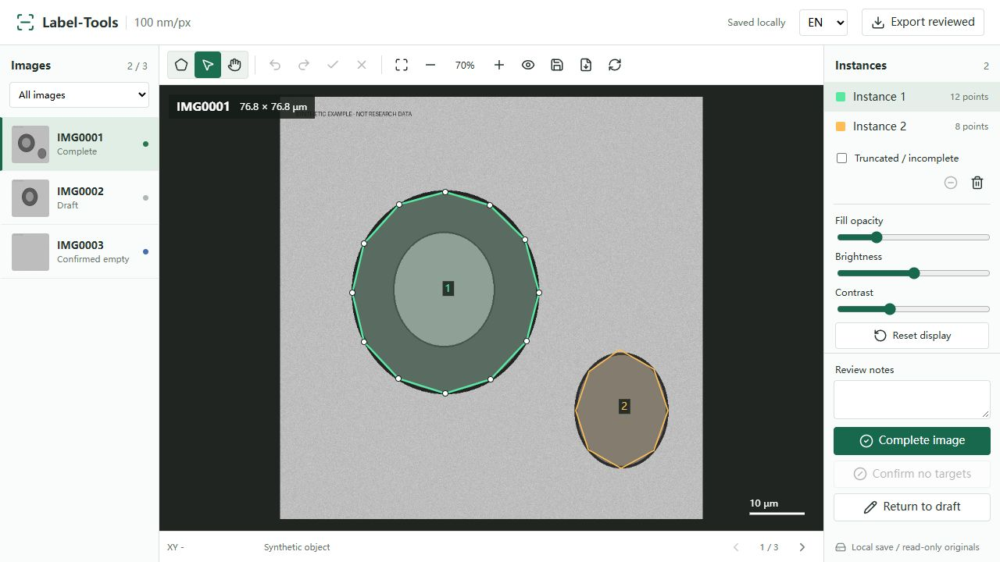
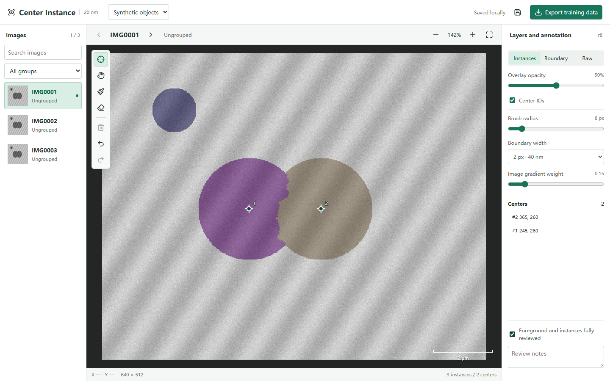

# Label-Tools

**Local-first instance annotation, explicit review, and lossless training-pair export.**

[中文说明](docs/README.zh-CN.md) · [Data format](docs/data-format.md) · [Architecture](docs/architecture.md) · [Contributing](CONTRIBUTING.md)

Label-Tools is a small Python + browser framework for drawing **2D instance polygons** and refining
existing masks with **instance center points**.
It runs on your computer, saves to your filesystem, and separates unfinished work from reviewed
positive and negative training examples. No cloud account, Node build step, or model download is required.



## What Is Included

- Polygon drawing, vertex editing, edge insertion, undo/redo, pan/zoom, and display adjustments.
- English and Chinese interfaces, with a dataset-specific target and optional physical pixel size.
- Multiple independently numbered instances per image; border-touching/incomplete instances are flagged.
- Disk autosave, JSON revision history, cross-process locking, and optimistic revision conflict checks.
- A separate browser draft cache and downloadable draft JSON for recovery after failed saves.
- Explicit **draft / complete / confirmed empty** review states.
- Lossless raw TIFF + uint16 instance TIFF + partial-target ignore mask exports.
- PNG/JPEG and single-image TIFF import, raw/preview checksums, and synthetic demo data.
- Optional center-point workspace: foreground add/erase, seeded instance splitting, live previews,
  revisioned annotations, and foreground + boundary training targets.

## Quick Start

Python 3.10 or newer is required. From a checkout of the implementation branch:

```bash
python -m venv .venv
# Linux/macOS: source .venv/bin/activate
# Windows PowerShell: .venv\Scripts\Activate.ps1
python -m pip install .

label-tools demo --output ../label-tools-demo
label-tools serve ../label-tools-demo --open
```

The default address is `http://127.0.0.1:8766`. Use `--port 8767` if that port is occupied.
The command also works as `python -m label_tools`. Keep the server running while annotating;
press Ctrl+C to stop it. The implementation is initially delivered through a PR, not a PyPI release.

## Use Your Images

```bash
label-tools init /path/to/images --output /path/to/workspace --resolution-nm 100 --target "Object outer boundary" --language en
label-tools verify /path/to/workspace
label-tools serve /path/to/workspace --open
```

For a Chinese interface, set `--language zh` or use the language selector. Omit `--resolution-nm`
when the pixel size is unknown; the interface then reports pixels, never an invented physical scale.
Inputs are read non-recursively. Existing output directories are never overwritten.

Grayscale integer and floating-point images retain their raw dtype and pixel values in TIFF.
Non-uint8 grayscale previews use a recorded display window, without changing exported raw pixels.
Color support is interleaved uint8 RGB. Alpha/palette images, stacks, and crops above 16 megapixels
must be converted or tiled before import.

## Annotation Workflow

1. Select an image and draw one closed polygon per object. Click along the boundary and press Enter
   while the canvas is focused, double-click, or click the first vertex to close it.
2. In edit mode, drag vertices, double-click an edge to insert a vertex, or delete the selected vertex.
   Use the wheel to zoom; pan mode or Space + drag moves the view.
3. Trace **all** objects in an image before marking it complete. Mark incomplete objects as partial.
   Explicitly confirm a field with no targets as empty. Leave uncertain or unfinished images as drafts.
4. Export reviewed data in the browser, or run `label-tools export /path/to/workspace`.

Closed contours autosave. Wait for **Saved locally** before closing the server. Unclosed paths are
browser-local drafts, not saved training labels. Invalid contours remain editable and are not committed.
Save errors, including concurrent edits from another tab, do not silently replace the saved revision.

## Training Semantics

**Unannotated is not negative.** Empty placeholders are not generated, and draft images are excluded
from training exports even if their current mask is all zero.

An export contains `images/`, `labels/`, `ignore_masks/`, `annotations/`, and a manifest.
Instance IDs start at 1 and are local to each image; 0 is background. `ignore_masks == 255`
marks partial targets. Your training adapter must honor this ignore mask; setting partial objects to
background would create false negatives. This package does not silently train a model.

Known overlapping fields are listed when spatial metadata is available. Keep overlapping crops in the
same split and check specimen-level independence yourself. Absence of an overlap entry does not prove
that two images are independent.

## Scope

Polygon workspaces support one object category, simple non-overlapping polygons, and 2D crops.
The optional center workspace refines existing grayscale-image masks, including touching instances.
It is not a WSI tile server, 3D annotator, collaborative web service, or clinical device.
Polygon mode does not support holes or touching/overlapping instance raster pixels. Use the original
desktop dataset separately; no research images or real annotations are distributed here.

## Center-Point Refinement

```bash
python -m pip install ".[centers]"
label-tools centers-demo --output ../center-demo
label-tools centers-serve ../center-demo --open
```

The center workspace defaults to `http://127.0.0.1:8772`. To import your own grayscale images,
binary foreground masks, and optional integer instance masks with matching filename stems:

```bash
label-tools centers-init /path/to/images --masks /path/to/foreground --instances /path/to/instances --output /path/to/center-workspace --resolution-nm 20 --target "Objects"
label-tools centers-serve /path/to/center-workspace --open
```

Omit `--instances` to initialize from foreground connected components. Omit `--resolution-nm` when
unknown. Add one center per object **inside a merged region** to split it; existing independent
instance IDs are retained. Points outside foreground are flagged, not silently moved. Add or erase
foreground explicitly when the coarse mask is wrong. Previews recompute locally after edits;
training TIFFs are generated only when you export.

Exports contain raw pixels, uint32 instances, foreground, boundary, interior, and ignore masks.
**Centers do not make an unreviewed foreground mask ground truth.** Review the full mask and all
instances before enabling the reviewed flag. The default strict training mask ignores an unreviewed
image entirely. Derived boundaries are algorithmic targets, not independently traced membranes.
See [center workflow and format](docs/center-points.md) for export semantics and limitations.



## Development

```bash
python -m pip install -e ".[dev,centers]"
python -m pytest
python -m ruff check src tests
python -m build
```

CI runs unit/HTTP tests and builds the package on Windows, Linux, and macOS. Tests generate synthetic
images in temporary directories. Browser QA covers actual canvas interactions; see
[the verification notes](docs/verification.md) for what was checked and what was not.

## Privacy and License

The server binds to loopback only, uses same-origin write checks and a per-process token, and bundles
its icons locally. There are no analytics or external frontend requests. Do not expose it through
a reverse proxy or open network interface. See [SECURITY.md](SECURITY.md).

Code: [MIT](LICENSE). Bundled icons: [third-party notices](THIRD_PARTY_NOTICES.md).
Synthetic examples are not microscopy measurements or biological evidence.
